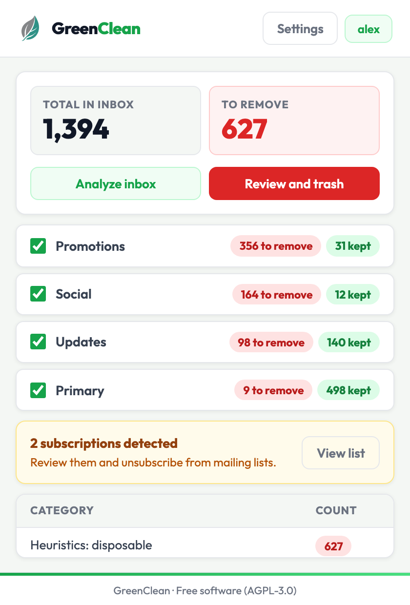
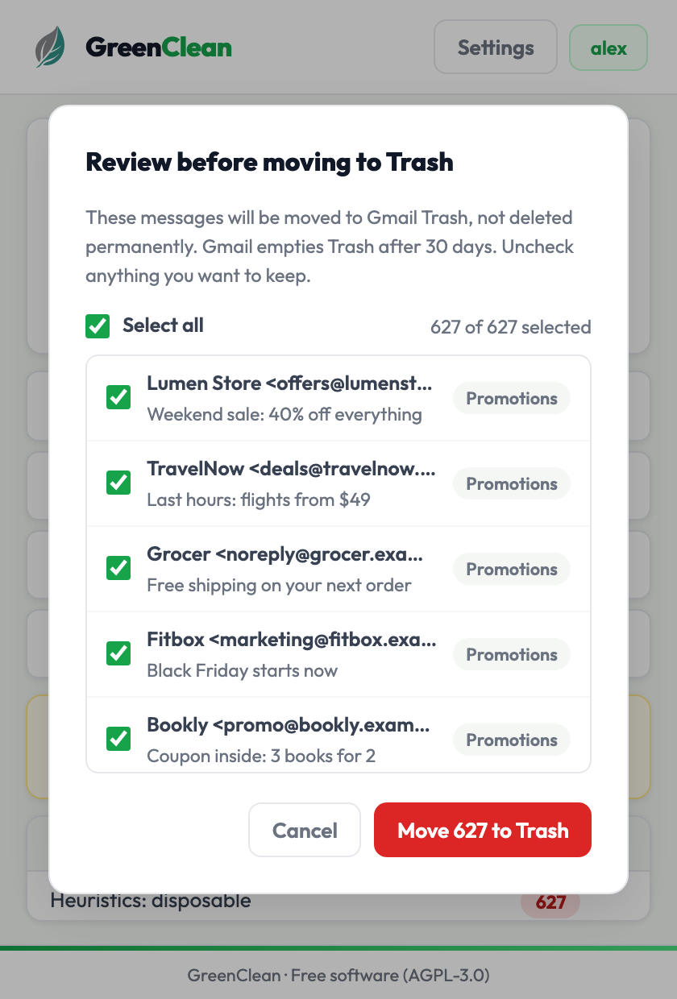
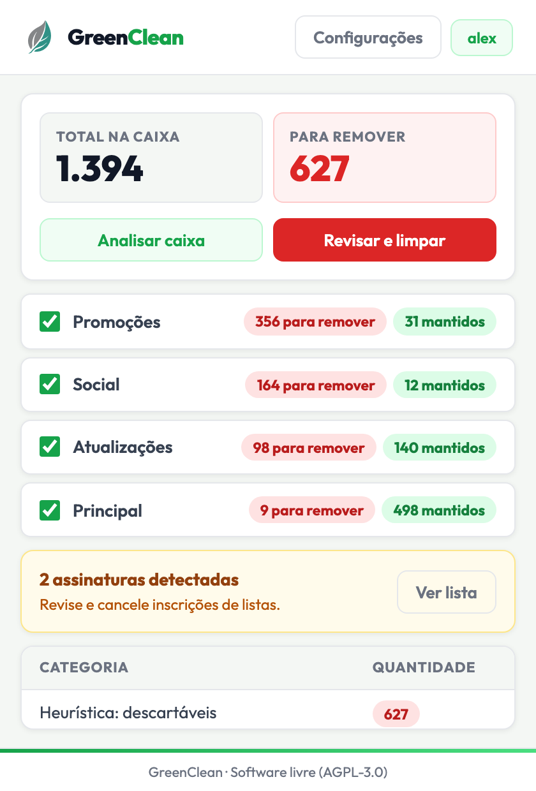

# GreenClean

Chrome extension (Manifest V3) that finds disposable mail and mailing-list subscriptions in a Gmail inbox and lets you review them before moving them to Trash or unsubscribing. Classification runs in the browser with heuristic rules; an AI classifier is optional and off by default. The interface is available in English and Brazilian Portuguese and follows the browser language.

The repository also contains `server/`, an optional self-hosted Node.js API for the "cloud AI" mode. The extension works without it.

<p>
  
  
  
</p>

*Screenshots of the built popup rendered with mocked inbox data.*

## How it works

```
Gmail inbox, one query per tab: Promotions, Social, Updates, Primary
        │
        ├─ messages.list            message IDs, 500 per page
        ├─ messages.get (metadata)  Subject, From, List-Unsubscribe and Gmail's snippet,
        │                           25 requests in parallel; message bodies are never fetched
        ▼
Heuristic classifier (local, src/classifier.js)
        ├─ List-Unsubscribe header, or unsubscribe text in the snippet  ──► Subscription
        ├─ sender pattern (noreply, newsletter, marketing, alerts@ ...)  ──► Disposable
        ├─ subject pattern (discounts, promotions, notifications, PT-BR and EN)  ──► Disposable
        └─ no match  ──► unclassified
                │
                ▼
AI classifier (optional, src/ai.js): unclassified messages only, batches of 30
        └─ Important | Neutral | Disposable  (only Disposable is marked for removal)
                │
                ▼
Results by Gmail tab  ──► review list (sender, subject, tab; uncheck to keep)  ──► Gmail Trash
Subscriptions, grouped by sender domain  ──► unsubscribe and/or move to Trash
```

Every tab, including Primary, goes through the same rules. A message is never marked for removal only because Gmail put it in Promotions or Social.

Before anything is removed, the popup lists every message that will be moved, with sender, subject and Gmail tab, and only the checked ones are sent to Gmail's `messages.trash`. Nothing is deleted permanently: Gmail keeps Trash for 30 days.

Unsubscribing uses the `List-Unsubscribe` header:

- HTTP(S) link: the background service worker opens it in an inactive tab, waits for the page to load and closes the tab. This is a GET visit, so it only works for links that unsubscribe on load; pages that need a click and RFC 8058 one-click POST endpoints are not handled.
- `mailto:` link (when there is no HTTP link): the extension sends a short "Please unsubscribe me" email from your Gmail account to that single address through the Gmail API. The address and subject come from the sender's header, so only one recipient is accepted and line breaks are stripped to prevent header injection.

## AI modes

Selected in the extension settings.

| Mode | Where classification runs | Credentials |
|---|---|---|
| Free (default) | Heuristics only, in the browser. No AI request is made. | None |
| Advanced (bring your own key) | The popup calls the provider directly: Google Gemini (`gemini-2.5-flash`, falling back to `gemini-2.0-flash-lite` and `gemini-2.0-flash`), OpenAI (default `gpt-4o-mini`), Anthropic (default `claude-haiku-4-5`) or a local Ollama (default `llama3` at `http://localhost:11434`). | Your provider API key; none for Ollama |
| Cloud | The popup calls `POST {base URL}/v1/categorize` on a GreenClean API server you run (see [Cloud API server](#cloud-api-server-optional)), which calls Anthropic with the server's key. There is no default server. The URL must be HTTPS; plain HTTP is accepted only for `localhost` and `127.0.0.1`. | Bearer token issued by your server |

When you save Advanced or Cloud mode, Chrome asks for access to that one host (see [Permissions](#permissions)). If you decline, the settings are kept but scans run with heuristics only until access is granted; the next scan asks again.

## Privacy

What leaves the browser depends on the mode.

**Sent to an AI provider or your cloud server** (Advanced and Cloud modes only, and only for messages the heuristics left unclassified), per message:

- the Gmail message ID;
- the subject, whitespace collapsed, truncated to 180 characters;
- Gmail's snippet (preview text), truncated to 200 characters, unless "Send the snippet to the AI" is turned off.

With "Mask email addresses and domains" on (the default), email addresses in the subject and snippet are replaced with `[email]` and domain names with `[domain]` before sending. The sender (`From`), other headers and the message body are never sent. The reference server forwards the same fields to the Anthropic API; it does not store requests and does not log subjects or snippets.

**Stays in the browser:**

- message metadata used by the heuristics (`From`, `List-Unsubscribe`, subject, snippet);
- settings, provider API keys and the cloud token: in the extension's `localStorage`, never in `chrome.storage.sync`, never logged;
- the last scan (message IDs; sender and subject of messages marked for removal; sender, subject and snippet of detected subscriptions): in `chrome.storage.local`, until you run a new scan, return to the start screen or remove the extension.

**Other network requests:**

- Google: Gmail API, OAuth through `chrome.identity`, `oauth2/v1/userinfo` to show the connected account, and token revocation (`POST https://oauth2.googleapis.com/revoke`, token in the request body) when switching accounts.
- Unsubscribe actions, only when you run them: the sender's unsubscribe page sees a normal visit from your browser, and a `mailto:` unsubscribe is a real email sent from your account. Both confirm to the sender that the address is active.

The popup loads no third-party resources: the Outfit font is bundled with the extension. There is no analytics or telemetry code. The full privacy policy is in [docs/privacy-policy.md](docs/privacy-policy.md).

## Permissions

| Manifest entry | Why |
|---|---|
| `identity` | Gets the Gmail OAuth token with `chrome.identity.getAuthToken`. |
| `oauth2` scope `gmail.modify` | Lists messages, reads metadata, moves messages to Trash and sends `mailto:` unsubscribe emails. It does not allow permanent deletion. |
| `storage` | Saves the last scan in `chrome.storage.local`. |
| `https://gmail.googleapis.com/*` | Gmail API. |
| `https://www.googleapis.com/*` | `oauth2/v1/userinfo` for the account email (the Gmail profile endpoint is the fallback). |
| `https://oauth2.googleapis.com/*` | Revokes the OAuth token when switching accounts. |
| `optional_host_permissions`: `https://generativelanguage.googleapis.com/*`, `https://api.openai.com/*`, `https://api.anthropic.com/*` | Not granted at install. Requested for the selected provider only, when you save Advanced mode. |
| `optional_host_permissions`: `https://*/*`, `http://localhost/*`, `http://127.0.0.1/*` | Not granted at install. Requested for the single origin of your cloud server or Ollama URL when you save that mode. |
| Content script on `https://mail.google.com/*` | Reads the page title or the account button label to detect which account the open Gmail tab uses and offer to switch to it. It reads no mail content. |
| `content_security_policy` `script-src 'self'; object-src 'self'` | Only scripts packaged with the extension run. All JavaScript, including the Gemini SDK, is bundled by Vite; no remote code is loaded. |
| `default_locale` `en`, `_locales/en`, `_locales/pt_BR` | Extension name, description and every UI string, through `chrome.i18n`. |

## Install from a release

Each `v*` tag builds a ZIP with GitHub Actions (`.github/workflows/release.yml`) and attaches it to the [GitHub Release](https://github.com/Hitice/greenclean/releases).

1. Download `greenclean-<version>.zip` from the latest release and extract it to a folder you will keep.
2. Open `chrome://extensions/` and turn on Developer mode.
3. Click "Load unpacked" and select the extracted folder.

An unpacked copy gets its own extension ID, and Google sign-in only works for the extension ID registered with the OAuth client in `manifest.json`. To sign in with an unpacked copy, register your own client as described in [Google OAuth client](#google-oauth-client) and rebuild from source.

## Development

Requirements: Google Chrome or Chromium, Node.js `^20.19.0 || >=22.12.0` (CI uses Node 22), npm.

```bash
git clone https://github.com/Hitice/greenclean.git
cd greenclean
npm ci
npm test
npm run build
```

`npm run build` writes the extension to `dist/`. Vite bundles the popup and copies `public/` (service worker, icons, logo, `_locales`); the `postbuild` step (`scripts/prepare-extension.mjs`) adds `manifest.json`, `src/content.js`, `LICENSE` and the font's license (`licenses/Outfit-OFL.txt`).

Load it in Chrome:

1. Open `chrome://extensions/` and turn on Developer mode.
2. Click "Load unpacked" and select `dist/`.
3. After each rebuild, click the reload icon on the extension card.

To add or change UI text, edit both `public/_locales/en/messages.json` and `public/_locales/pt_BR/messages.json`; `tests/manifest-i18n.test.js` fails if a key used in `index.html`, `src/` or the manifest is missing from either locale, or if `$1`-style substitutions differ between them.

### Google OAuth client

The `oauth2.client_id` in `manifest.json` belongs to the author's extension ID. An unpacked copy gets a different ID, so you need your own client:

1. In [Google Cloud Console](https://console.cloud.google.com/), create a project and enable the [Gmail API](https://console.cloud.google.com/apis/library/gmail.googleapis.com).
2. Configure the OAuth consent screen and add your Google account as a test user.
3. Under Credentials, create an OAuth client ID of type "Chrome Extension" with the ID shown for the unpacked extension in `chrome://extensions/`.
4. Put the client ID in `manifest.json` under `oauth2.client_id`, run `npm run build` and reload the extension.

### Ollama

Start Ollama on port 11434 and pull the model you set in the extension (`ollama pull llama3` for the default). If Ollama answers 403, allow the extension origin by starting it with `OLLAMA_ORIGINS=chrome-extension://<extension-id>`.

### Cloud API server (optional)

`server/` is an Express API that receives the fields listed in [Privacy](#privacy) and asks Anthropic to classify them.

```bash
cd server
npm ci
cp .env.example .env   # set ANTHROPIC_API_KEY and JWT_SECRET (openssl rand -base64 48)
npm test
npm start              # http://127.0.0.1:8787
npm run token:dev      # prints a 30-day test JWT signed with JWT_SECRET
```

Or with Docker: `docker compose up --build` inside `server/`.

Then select "Cloud AI" in the extension settings and enter the server URL and token.

- Endpoints: `GET /health`, `GET /ready` and `POST /v1/categorize` (up to 30 messages per request).
- Auth: Bearer token, either an HS256 JWT signed with `JWT_SECRET` (at least 32 characters) or one of the static `API_TOKENS`, compared in constant time.
- Rate limit: per IP, 60 requests per 15 minutes by default.
- Errors from the AI provider, including timeouts (30 s) and unusable model output, return a generic `502` with no upstream detail.
- With `NODE_ENV=production` the server refuses to start unless `CORS_ORIGINS` is set (for example `chrome-extension://<extension-id>`) and any `JWT_SECRET` is at least 32 characters. Requests from other origins receive no CORS headers.

The request and response format is in [server/api-contract.md](server/api-contract.md).

## Tests

```bash
npm test                  # extension
cd server && npm test     # server
```

Both use the Node.js test runner (`node:test`) with no extra test dependencies.

- Extension (`tests/`): heuristic classifier, `List-Unsubscribe` parsing, `mailto:` message construction including header-injection cases, cloud URL validation and the host permission each mode requests, legacy settings migration, the pre-trash candidate list, token revocation request shape, locale completeness, and manifest checks (no required AI hosts, no `tabs` permission, CSP, version match with `package.json`).
- Server (`server/test/`): configuration rules (production CORS, JWT secret length), bearer auth with static tokens and JWTs, constant-time token matching, mapping of provider failures to `502` without detail, `503` without a key, body limits, CORS allow list and request ID validation. The server is started on an ephemeral port with a stubbed AI client; no network calls are made.

CI (`.github/workflows/ci.yml`) runs `npm ci`, `npm test` and `npm run build` for the extension and `npm ci` and `npm test` for the server on every push to `main` and every pull request.

## Project structure

```
greenclean/
├── manifest.json              Manifest V3 (copied to dist/ on build)
├── index.html                 Popup markup (text comes from _locales)
├── src/
│   ├── main.js                Popup controller: scan, review, trash, settings
│   ├── gmail.js               Gmail REST wrapper: OAuth token, pagination, metadata fetch, trash, revoke
│   ├── classifier.js          Heuristic classifier
│   ├── ai.js                  AI classifier: cloud mode and Gemini, OpenAI, Anthropic, Ollama
│   ├── ai-config.js           Mode identifiers; cloud defaults (empty)
│   ├── settings.js            URL validation, host permissions per mode, settings migration
│   ├── scan-results.js        Pre-trash candidate list and stored preview records
│   ├── unsubscriber.js        List-Unsubscribe parsing, mailto unsubscribe through Gmail
│   ├── i18n.js                chrome.i18n wrapper and data-i18n binding
│   ├── content.js             Content script on mail.google.com (account detection)
│   └── style.css
├── public/
│   ├── _locales/{en,pt_BR}/messages.json
│   ├── background.js          Service worker: opens HTTP unsubscribe links in background tabs
│   ├── logo.svg
│   └── icon-*.png
├── scripts/
│   ├── prepare-extension.mjs  postbuild: copies manifest, content script and licenses to dist/
│   └── generate-icons.mjs     Regenerates icon-*.png from logo.svg (needs: npm install --no-save sharp)
├── tests/                     Extension tests (node:test)
├── server/                    Optional self-hosted cloud AI API (Express, Anthropic) with its own tests
├── docs/
│   ├── privacy-policy.md
│   └── screenshots/
└── .github/workflows/         ci.yml, release.yml
```

## License

Copyright (C) 2024-2026 Pedro Henrique Fernandes

GNU Affero General Public License v3.0. See [LICENSE](LICENSE). The bundled Outfit font is licensed under the SIL Open Font License 1.1.
